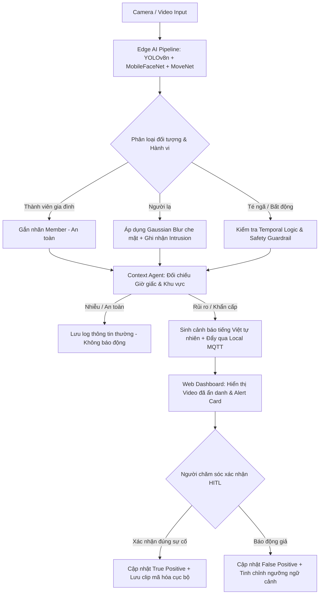
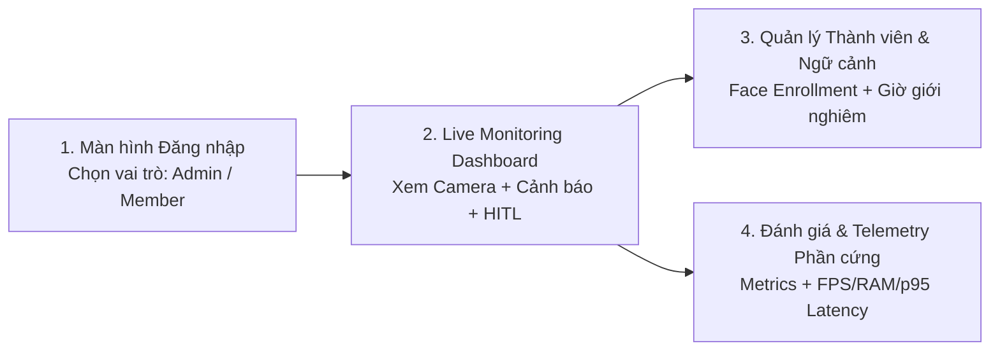

# UI FLOW & WIREFRAMES: GUARDIANCAM HOME

* **Mã đề tài:** DEV-12
* **Tên sản phẩm:** GuardianCam Home — Hệ thống an ninh gia đình On-Device
* **Tài liệu:** Luồng tương tác người dùng (UI Flow) & Phác thảo giao diện (Wireframes)
* **Nhóm thực hiện:**
  1. Trần Đức Mạnh — MSSV: `2A202603615`
  2. Nguyễn Anh Quân — MSSV: `2A202603950`
  3. Lê Anh Quân — MSSV: `2A202603576`
  4. Nguyễn Hữu Thịnh — MSSV: `2A202603726`

---

## 1. Sơ đồ luồng xử lý & Tương tác người dùng (End-to-End UI Flow)

Sơ đồ dưới đây mô tả luồng dữ liệu khép kín tại thiết bị biên (On-Device) và cách người chăm sóc / thành viên tương tác với cảnh báo qua cơ chế **Human-in-the-Loop (HITL)**:

---

## 2. Luồng điều hướng màn hình (User Navigation Flow)

---

## 3. Phác thảo giao diện chi tiết (Screen Wireframes)

### Màn hình 1: Đăng nhập & Phân quyền (Login & Role Selection)
*Đáp ứng yêu cầu đăng nhập ≥ 2 vai trò: Quản trị viên/Người chăm sóc và Thành viên gia đình.*

    +-----------------------------------------------------------------------+
    |  GUARDIANCAM HOME (ON-DEVICE EDGE AI)               [Status: OFFLINE] |
    +-----------------------------------------------------------------------+
    |                                                                       |
    |                     +-----------------------------------+             |
    |                     |      ĐĂNG NHẬP HỆ THỐNG           |             |
    |                     |                                   |             |
    |                     |  Tài khoản: [ admin_caregiver  ]  |             |
    |                     |  Mật khẩu:  [ •••••••••••••••  ]  |             |
    |                     |                                   |             |
    |                     |  Vai trò truy cập:                |             |
    |                     |  (•) Quản trị / Người chăm sóc    |             |
    |                     |  ( ) Thành viên gia đình          |             |
    |                     |                                   |             |
    |                     |       [   ĐĂNG NHẬP CỤC BỘ   ]    |             |
    |                     +-----------------------------------+             |
    |                                                                       |
    |  * Cam kết quyền riêng tư: 100% dữ liệu xử lý cục bộ, không Cloud.    |
    +-----------------------------------------------------------------------+

---

### Màn hình 2: Bảng điều khiển Giám sát & Xác nhận HITL (Main Dashboard)
*Màn hình trung tâm hiển thị video đã làm mờ khuôn mặt người lạ, danh sách cảnh báo tiếng Việt và nút HITL.*

    +-----------------------------------------------------------------------+
    | GUARDIANCAM HOME | [Giám sát] | [Thành viên & Lịch] | [Đánh giá Edge] |
    | Role: Quản trị viên (Trần Đức Mạnh)        Mode: 100% On-Device Local |
    +-----------------------------------------------------------------------+
    | +-----------------------------------+ +-----------------------------+ |
    | | CAMERA 01: CỬA SAU (02:15 AM)     | | NHẬT KÝ CẢNH BÁO & HITL     | |
    | |                                   | |                             | |
    | |   +---------------------------+   | | [CRITICAL] 02:15:12         | |
    | |   |   [BLURRED FACE]          |   | | "Phát hiện người lạ tại     | |
    | |   |   Label: Stranger (0.91)  |   | |  Cửa sau lúc 02:15 sáng     | |
    | |   |       +---------+         |   | |  (ngoài giờ an toàn)."      | |
    | |   |       |  BODY   |         |   | | [Đúng sự cố] [Báo động giả] | |
    | |   |       |  BBOX   |         |   | |-----------------------------| |
    | |   |       +---------+         |   | | [EMERGENCY] 14:30:05        | |
    | |   +---------------------------+   | | "Cảnh báo té ngã người cao  | |
    | |                                   | |  tuổi tại Phòng khách!"     | |
    | | Privacy Guard: ON (Face Blurred)  | | [Đúng sự cố] [Báo động giả] | |
    | | Safety Interlock: ACTIVE          | |-----------------------------| |
    | +-----------------------------------+ | [INFO] 20:10:00             | |
    | | EDGE TELEMETRY NHANH:             | | "Thành viên Trần Đức Mạnh   | |
    | | FPS: 24.5 | Latency p95: 41ms     | |  về nhà qua Cửa trước."     | |
    | | RAM: 612 MB / 4096 MB             | | (Tự động bỏ qua báo động)   | |
    | +-----------------------------------+ +-----------------------------+ |
    +-----------------------------------------------------------------------+

---

### Màn hình 3: Quản lý Khuôn mặt Thành viên & Bộ nhớ Ngữ cảnh (Admin Only)
*Cho phép người chăm sóc đăng ký khuôn mặt thành viên (MobileFaceNet embedding) và cấu hình giờ giới nghiêm.*

    +-----------------------------------------------------------------------+
    | GUARDIANCAM HOME | [Giám sát] | [Thành viên & Lịch] | [Đánh giá Edge] |
    +-----------------------------------------------------------------------+
    | 1. DANH SÁCH KHUÔN MẶT THÀNH VIÊN (LOCAL MEMORY)                      |
    | +-------------------------------------------------------------------+ |
    | | [+ Đăng ký khuôn mặt mới]  Tên: [___________]  Ảnh: [Upload File] | |
    | +-------------------------------------------------------------------+ |
    | | • Trần Đức Mạnh (Admin)      | Embedding: Ready | [Xóa]           | |
    | | • Nguyễn Anh Quân (Member)   | Embedding: Ready | [Xóa]           | |
    | | • Bà Nội (Elderly Care)      | Fall Priority: HIGH | [Xóa]      | |
    | +-------------------------------------------------------------------+ |
    |                                                                       |
    | 2. CẤU HÌNH NGỮ CẢNH & GIỜ GIỚI NGHIÊM (CONTEXT RULES)                |
    | +-------------------------------------------------------------------+ |
    | | Khu vực: [Cửa sau]   | Khung giờ giới nghiêm: [23:00] - [05:30]   | |
    | | Chế độ lọc nhiễu:    | [x] Bỏ qua thú cưng (Chó/Mèo)              | |
    | |                      | [x] Yêu cầu >= 5 frames liên tiếp (Guard)  | |
    | +-------------------------------------------------------------------+ |
    +-----------------------------------------------------------------------+

---

### Màn hình 4: Báo cáo Đánh giá Mô hình & Benchmark Phần cứng Biên
*Phục vụ nghiệm thu các chỉ số Precision/Recall, False Positive Rate và so sánh lượng tử hóa mô hình.*

    +-----------------------------------------------------------------------+
    | GUARDIANCAM HOME | [Giám sát] | [Thành viên & Lịch] | [Đánh giá Edge] |
    +-----------------------------------------------------------------------+
    | 1. CHỈ SỐ ĐỘ CHÍNH XÁC TỪ PHẢN HỒI HITL                               |
    | +-----------------------+-----------------------+-------------------+ |
    | | Fall Detection Recall | Intrusion Precision   | False Positive    | |
    | |        98.5%          |        94.2%          |       2.1%        | |
    | | (Ưu tiên an toàn cao) | (Giảm nhiễu thành công)| (Thú cưng/ánh sáng| |
    | +-----------------------+-----------------------+-------------------+ |
    |                                                                       |
    | 2. BENCHMARK PHẦN CỨNG BIÊN & LƯỢNG TỬ HÓA (ONNX / TFLITE)            |
    | +------------------+----------+-------------+-----------+-----------+ |
    | | Cấu hình Model   | Size (MB)| FPS Trungbình| p95 Latency| RAM/VRAM | |
    | +------------------+----------+-------------+-----------+-----------+ |
    | | YOLOv8n (FP32)   | 12.8 MB  | 14.2 FPS    | 72 ms     | 980 MB    | |
    | | YOLOv8n (INT8/Q8)|  3.4 MB  | 25.8 FPS    | 38 ms     | 540 MB    | |
    | | MobileFaceNet Q8 |  1.2 MB  | 45.0 FPS    | 18 ms     | 190 MB    | |
    | +------------------+----------+-------------+-----------+-----------+ |
    +-----------------------------------------------------------------------+
